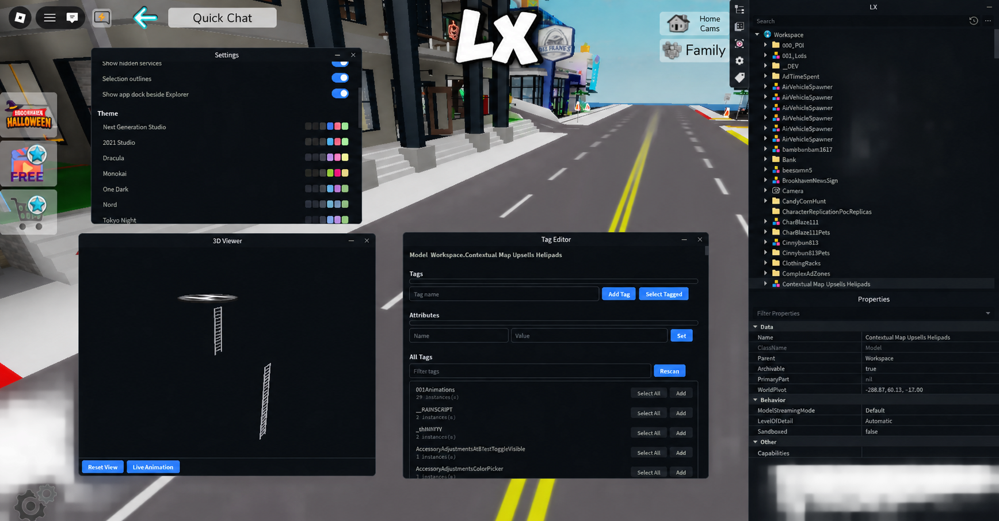

<div align="center">
  
  <h1>LX</h1>
  <p>
    <strong>a cool lil explorer for Roblox debugging</strong>
  </p>
  <p>
    <a href="https://discord.gg/x3eUsw4vdH">
      
    </a>
    <a href="https://github.com/LXExplorer/LX">
      
    </a>
    <a href="https://github.com/LXExplorer/LX">
      
    </a>
  </p>
</div>

LX is a Roblox debugging tool made for exploring ROBLOX games to a high degree

If you want to hang out, ask questions, or get help with LX then visit the Discord server 

> [!WARNING]
> This is mainly for educational and debugging use. Some features depend on what your executor can do, so they MAY not work everywhere!

<div align="center">
  
</div>

LX helps you inspect stuff in a Roblox game, like:

- Script contents
- instance tree
- 3D viewer
- Notepad
- Hooks
- Dumping scripts and places when your executor supports it
- Exporting remotes, attributes, tags, and bytecode (may be buggy as i am still in the process of rewriting it)


## Main Loader

```lua
local Library = loadstring(game:HttpGet("https://raw.githubusercontent.com/LXExplorer/LX/main/Loader.lua"))()
```

If you want to use the example plugins that come with the repo:

```lua
local Library = loadstring(game:HttpGet("https://raw.githubusercontent.com/LXExplorer/LX/main/Loader.lua"))()
Library.LoadPlugin("plugins/QuickSearch.lua")
Library.LoadPlugin("plugins/CopyPaths.lua")
Library.LoadPlugin("plugins/PlaceInfo.lua")
```

## Info

- Plugins add extra tools and shortcuts.
- Some features will only work if your executor exposes that capability as stated.


## For Plugin Devs

The repo has a small plugin system. You can start from the example files in the repo and change them.

Basic example:

```lua
local Library = loadstring(readfile("lib/LX.lua"))()
local plugin = loadstring(readfile("examples/MyPlugin.lua"))()
plugin(Library)
```

The full notes are in [docs/Plugins.md](docs/Plugins.md).

## Hierarchy

- [Loader.lua](Loader.lua) loads the main script
- [LX.lua](LX.lua) is the main explorer
- [lib/LX.lua](lib/LX.lua) is the library API
- [plugins/](plugins) contains the bundled plugins
- [examples/](examples) contains example scripts
- [docs/Plugins.md](docs/Plugins.md) has the deeper plugin notes

## Notes

- This project is still in Beta and as ROBLOX continues with their horrible updates it could coderot but hopefully i manage to maintain it in my freetime :)


## Additional

There is also LX Explorer for the all knowing which is restricted

This is the private tester version of LX. It is for trusted users, contributors, and other special people

This version contains:

- Script editing
- Datastore inspection and management
- Secret viewer
- Better 3D viewer
- 5 built in plugins
- Priority support


Made with 💙 by Aero
